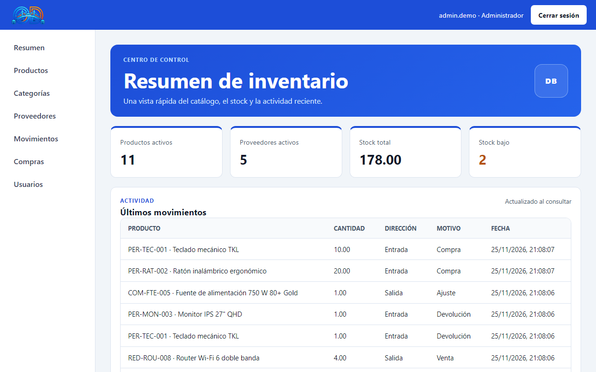
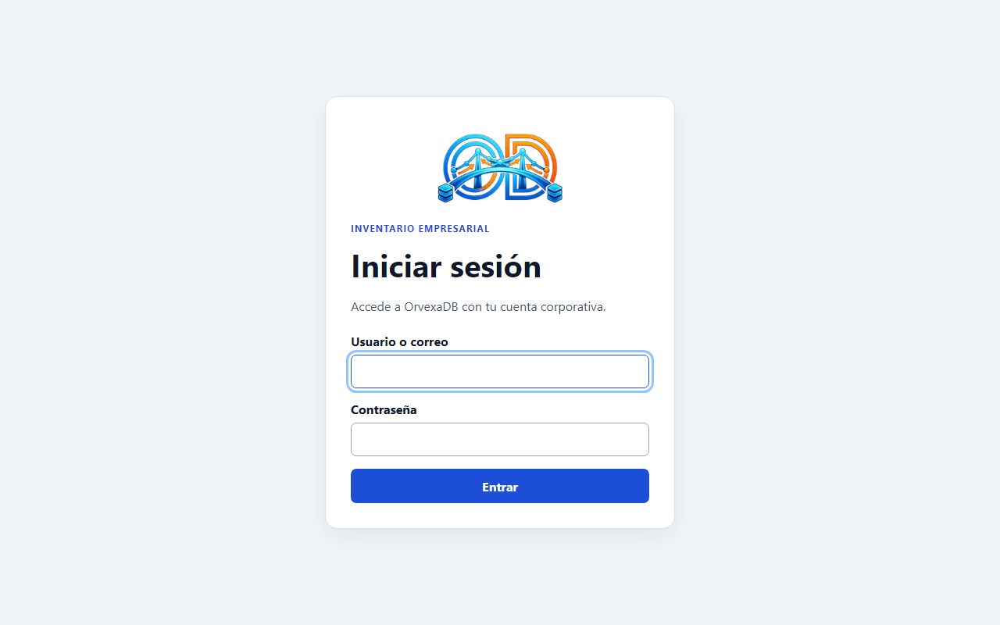
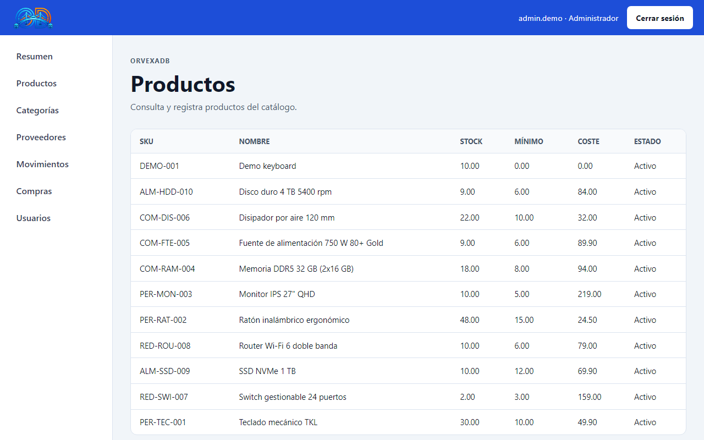
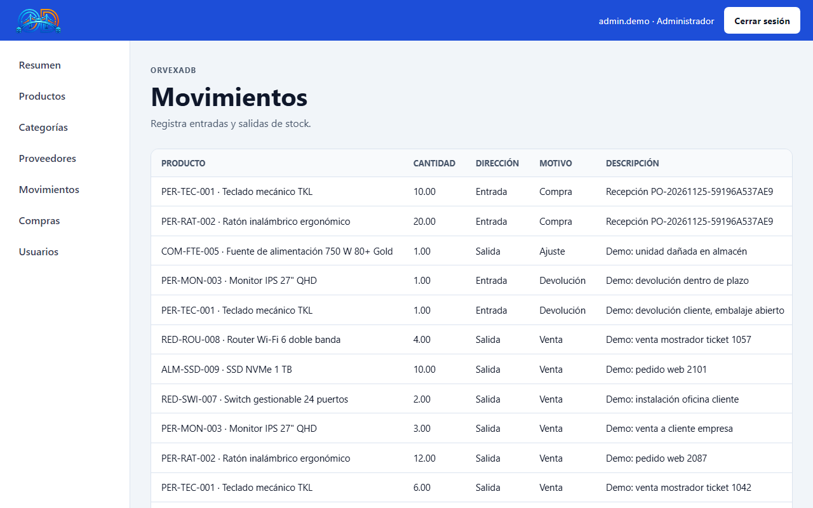
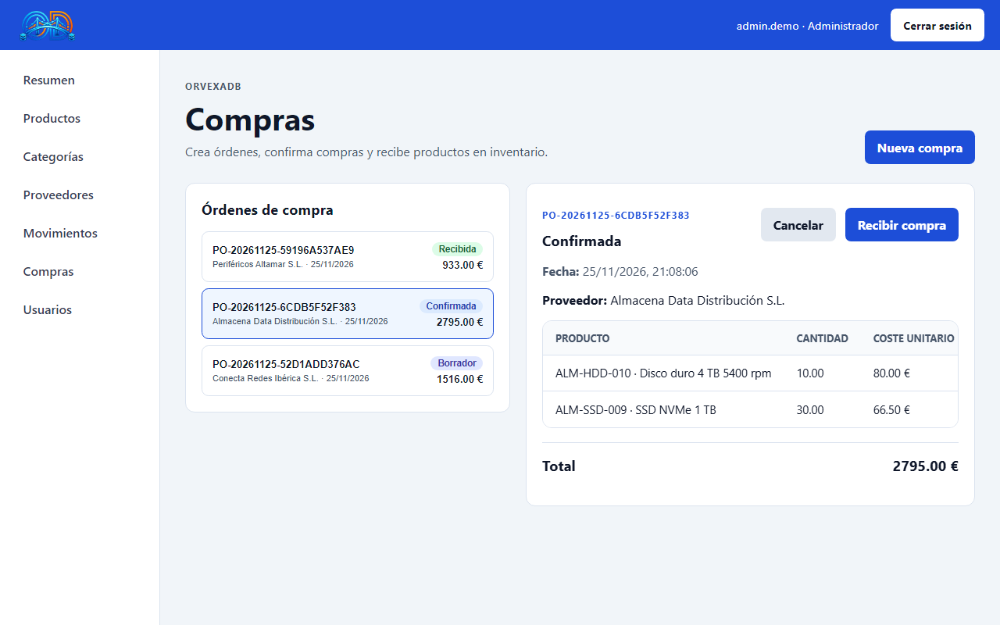
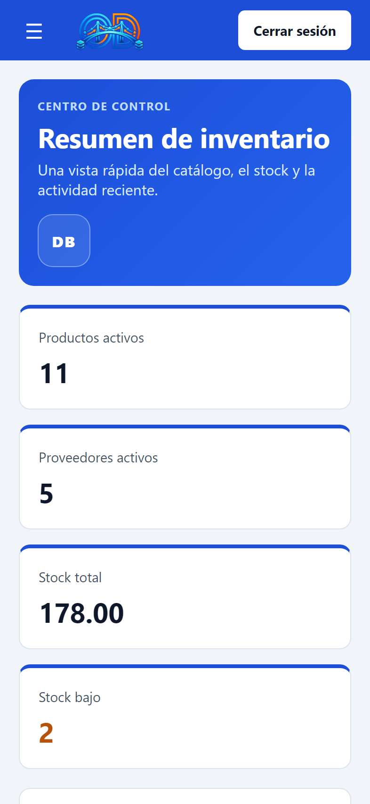

# OrvexaDB

OrvexaDB es una aplicación web local para gestionar un inventario PostgreSQL sin usar SQL directamente. La interfaz visible se sirve en `http://localhost:3000`; Next.js reenvía las peticiones `/api/*` a FastAPI dentro de la red de Compose.

Pensada para una pequeña empresa: controla el catálogo de productos, el stock y las compras a proveedores desde el navegador, con roles, auditoría y alertas de stock bajo.

**Tecnologías:** Next.js 16 · React 19 · TypeScript · FastAPI · Python 3.12 · SQLAlchemy · Alembic · PostgreSQL 18 · Docker Compose · Vitest · Playwright · pytest

## Capturas



| Inicio de sesión | Productos | Movimientos |
| --- | --- | --- |
|  |  |  |

| Órdenes de compra | Dashboard en móvil |
| --- | --- |
|  |  |

Las capturas usan solo los [datos de demostración](#datos-de-demostración).

## Funcionalidades

- Catálogo de productos con SKU, coste unitario, stock actual y stock mínimo.
- Categorías y proveedores con baja lógica.
- Movimientos de stock (compra, venta, ajuste y devolución) con control de saldo insuficiente.
- Alertas de stock bajo y resumen de inventario en el dashboard.
- Órdenes de compra: borrador, confirmación, cancelación y recepción que actualiza el stock en una sola transacción.
- Roles Administrador y Empleado con permisos por acción.
- Auditoría interna de las operaciones relevantes.
- Sesiones seguras con cookies opacas, protección CSRF y contraseñas con Argon2id.
- Tests unitarios, de integración con PostgreSQL real y E2E con Playwright en escritorio y móvil.

## Uso del repositorio

Este repositorio se publica solo para mostrar el proyecto. Todos los derechos reservados. No se concede permiso para copiar, modificar, distribuir ni reutilizar su código o recursos sin autorización expresa del titular.

## Estado

La Fase 1 proporciona la base de la aplicación, PostgreSQL, Alembic, seed idempotente y healthchecks. La Fase 2 añade autenticación por sesiones opacas, autorización por permisos, administración de usuarios, catálogo, movimientos de inventario y resumen del dashboard. La Fase 3 añade órdenes de compra, confirmación, cancelación y recepción completa idempotente con actualización transaccional de stock. Cada instalación administra una sola base PostgreSQL y una sola empresa. La gestión de varias bases o empresas requiere diseño y pruebas propios y queda fuera de esta fase. Importación, exportación, consulta administrativa de auditoría, backup/restauración integrados y despliegue público del servicio quedan fuera de alcance; el respaldo operativo pre-migración y la publicación del código en GitHub forman parte del cierre de Fase 4.

La validación final local aplicó `0004_purchase_orders` después de crear y verificar un respaldo externo. Se comprobaron seis recuentos previos, las tablas nuevas de compras quedaron vacías y la API y la web permanecieron saludables. La recepción sigue siendo completa; no se admiten recepciones parciales. El E2E final de Fase 4 pasó `24/24` casos y la revisión visual pasó `2/2` viewports: `1280x800` y `393x852`, con contraste, foco, etiquetas accesibles y ausencia de desbordamiento horizontal comprobados.

## Requisitos

- Docker Desktop con Compose v2.
- Node.js 24 y npm 11 para trabajar con el frontend fuera de Docker.
- Python 3.12 y `uv` para trabajar con la API fuera de Docker.

## Inicio seguro

```powershell
if (Test-Path .env) {
  throw '.env ya existe; no se sobrescribe. Usa el archivo existente y cambia sus valores localmente.'
}
Copy-Item .env.example .env
$password = [System.Net.NetworkCredential]::new('', (Read-Host 'Contraseña local de PostgreSQL' -AsSecureString)).Password
(Get-Content .env) -replace '^POSTGRES_PASSWORD=.*$', "POSTGRES_PASSWORD=$password" | Set-Content .env
$pepper = [Convert]::ToBase64String([Security.Cryptography.RandomNumberGenerator]::GetBytes(48))
(Get-Content .env) -replace '^AUTH_PEPPER=.*$', "AUTH_PEPPER=$pepper" | Set-Content .env
Remove-Variable password,pepper
docker compose up --build -d
docker compose exec api alembic upgrade head
docker compose exec api python -m app.seed
```

El valor de `AUTH_PEPPER` se escribe en el `.env` ignorado por Git y no se muestra en pantalla. No hay una cuenta administrativa predeterminada. Crea el primer administrador mediante el procedimiento de [seguridad](docs/security.md).

`POSTGRES_PASSWORD` y `AUTH_PEPPER` son secretos locales. No los publiques ni los incluyas en informes, logs o imágenes.

En Windows, con Docker Desktop abierto y el `.env` ya creado, `iniciar-orvexa.bat` ejecuta esos tres comandos y abre el navegador.

Abra `http://localhost:3000`. La API tiene `/api/v1/health/live` y `/api/v1/health/ready`; este último comprueba la conexión con PostgreSQL y es el healthcheck de Compose.

Antes de exponer la aplicación fuera del entorno local configura HTTPS, cookies seguras (`AUTH_COOKIE_SECURE=true`) y revisa el proxy inverso y sus cabeceras.

## Desarrollo y pruebas

API local:

```powershell
cd apps/api
uv sync --frozen --extra test
uv run ruff check .
uv run pytest -q
```

Frontend local:

```powershell
cd apps/web
npm ci
npm run lint
npm run typecheck
npm test
```

La integración PostgreSQL usa una base aislada indicada por `TEST_DATABASE_URL`. No usa SQLite. Consulta [testing.md](docs/testing.md) para el flujo completo y el registro de la validación local.

## Documentación

- [Arquitectura](docs/architecture.md)
- [Modelo de datos](docs/data-model.md)
- [Seguridad y administración](docs/security.md)
- [Matriz de permisos y rutas](docs/permissions.md)
- [Estrategia de pruebas](docs/testing.md)

## Persistencia y demostraciones

El volumen `orvexadb_pgdata` contiene la base local principal. Para reiniciar servicios usa `docker compose restart`; no uses `down -v` si quieres conservarla. Para una demostración descartable usa otro proyecto Compose y otro volumen, siguiendo [testing.md](docs/testing.md). Nunca publiques credenciales ni uses datos reales en las pruebas.

## Datos de demostración

`app.demo_data` carga un conjunto ficticio en español: 4 categorías, 4 proveedores, 10 productos (2 por debajo del stock mínimo), movimientos de compra, venta, ajuste y devolución, y 3 órdenes de compra (borrador, confirmada y recibida). También crea los usuarios `admin.demo` (Administrador) y `empleado.demo` (Empleado).

```powershell
docker compose exec api python -m app.demo_data
```

Requiere haber ejecutado antes `alembic upgrade head` y `python -m app.seed`. Es idempotente: solo crea lo que falta y no borra ni modifica datos existentes. Los movimientos y las compras pasan por la misma lógica que la API, así que el stock y la auditoría quedan coherentes. Las contraseñas de los usuarios demo se generan al crearlos y se muestran una sola vez por consola; no se guardan en ningún archivo. Para no mezclarlos con datos propios, cárgalos en un proyecto Compose aparte, como se indica en [testing.md](docs/testing.md).
